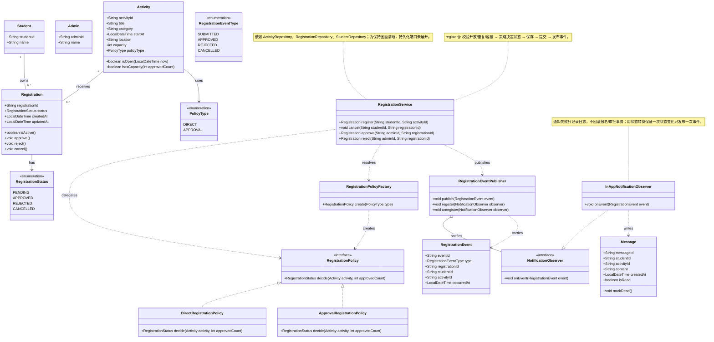

# CampusEvent UML 类图（设计 V1）

**阶段**：设计 V1 基线 + change-v2 CR 标注（绿色=新增、黄色=修改；V1 快照见 `baseline-v1`）  
**语言风格**：语言中立 UML；Java 实现时可按此映射  
**图形版本**：[类图](diagrams/class-diagram.drawio.svg)（draw.io 源文件见 `diagrams/CampusEvent-design.drawio`）

## 1. 类图

## 2. 职责说明

| 类/接口 | 职责 |
|---|---|
| `Student`、`Admin` | 固定演示账号的参与者实体，不承担复杂权限逻辑 |
| `Activity` | 活动数据与自身规则：是否开放报名、是否还有容量 |
| `Registration` | 报名记录与状态转换：通过、拒绝、取消；状态变化必须受规则约束 |
| `RegistrationStatus` | 待审核、已通过、已拒绝、已取消 |
| `PolicyType` | 活动报名方式：直接报名、审核型报名 |
| `RegistrationPolicy` | 策略接口：只决定报名初始状态，不承担名额检查 |
| `DirectRegistrationPolicy` | 直接返回“已通过” |
| `ApprovalRegistrationPolicy` | 返回“待审核” |
| `RegistrationPolicyFactory` | 根据 `PolicyType` 选择具体策略 |
| `RegistrationService` | 报名、取消、审批的应用服务；编排事务、规则与通知 |
| `RegistrationEvent` | 报名状态变化事件；携带事件类型和业务标识 |
| `RegistrationEventPublisher` | 事件发布与观察者注册/注销，等价于观察者模式中的 Subject |
| `NotificationObserver` | 通知观察者接口 |
| `InAppNotificationObserver` | 把事件转换为站内 `Message` |
| `Message` | 站内消息记录，支持已读标记 |

## 3. 关键设计决策

### 3.1 策略模式：只隔离“报名结果”，不隔离“名额规则”

- `RegistrationPolicy` 的输入是活动与当前已通过人数，输出是报名初始状态。
- 直接报名返回 `APPROVED`；审核型返回 `PENDING`。
- **名额是否足够、活动是否开放、是否重复报名属于公共服务规则**，放在 `RegistrationService`（调用 `Activity.isOpen/hasCapacity` 与仓储查询），不放进策略。
- 理由：两种报名方式都要遵守容量与时间约束；若把容量检查放进策略，会重复实现同一不变量，也会让策略职责从“决定结果”膨胀为“决定能否报名”。

### 3.2 观察者：报名事务与通知解耦

- `RegistrationService` 只依赖 `RegistrationEventPublisher`，不知道站内消息如何写入。
- `InAppNotificationObserver` 实现 `NotificationObserver`，通过 `Message` 写站内消息。
- 不使用消息队列；同步发布即可满足课程范围。
- 事务边界：先提交报名/审批状态，再发布事件；通知失败记录日志，不回滚业务事务。
- 防重复：状态转换只允许一次（例如待审核→已通过），事件由状态转换触发；同一状态变化不重复发布。

### 3.3 并发与容量

- 报名和审批都在事务开始时对 Activity 行执行 SELECT ... FOR UPDATE，再重新统计“已通过”人数；不做乐观锁重试。
- 直接报名名额竞争：只有一个事务成功；失败方返回“名额已满”。
- 审批最后一个名额竞争：只有一个批准成功；另一个保持“待审核”并提示容量已满。

## 4. 与用例的追踪

| 类/接口 | 主要服务的用例 |
|---|---|
| `Activity`、`Registration`、`RegistrationService` | UC-01、UC-04、UC-05、UC-06、UC-07 |
| `RegistrationPolicy` 及两个实现 | UC-04、UC-05 |
| `RegistrationEventPublisher`、`NotificationObserver`、`Message` | UC-04、UC-05、UC-06、UC-07、UC-08 |
| `RegistrationStatus` | UC-04—UC-07 |

## 5. 说明与边界

- 本图聚焦领域对象、策略与通知协作；`ActivityRepository`、`RegistrationRepository`、`StudentRepository`、`MessageRepository` 作为持久化端口在实现阶段补充，图面以 note 标注。
- 未引入消息队列、分布式事务、复杂权限；与实验二“无须引入消息队列”的边界一致。
- 变更版类图已在 change-v2 中叠加 CR 标注：绿色=新增、黄色=修改，`[NEW]`/`[CHG]` 为文字标记；V1 结构见 `baseline-v1`。
- 主要变更点：`Student.grade`；`PolicyType.GRADE_LIMITED_DIRECT`；`RegistrationPolicy.decide(RegistrationContext)`；`RegistrationService.studentMapper`；新增 `RegistrationContext`、`GradeLimitedDirectRegistrationPolicy`、`EmailNotificationObserver`、`EmailSender`、`MockEmailSender`、`EmailMessage`、`EmailLog`、`EmailLogMapper`、`SchemaMigration`。
- 本文件 Mermaid 仍描述 V1；change-v2 以本页 SVG 与 draw.io 第 2 页“CR-01 / CR-02 变更区”为准。
