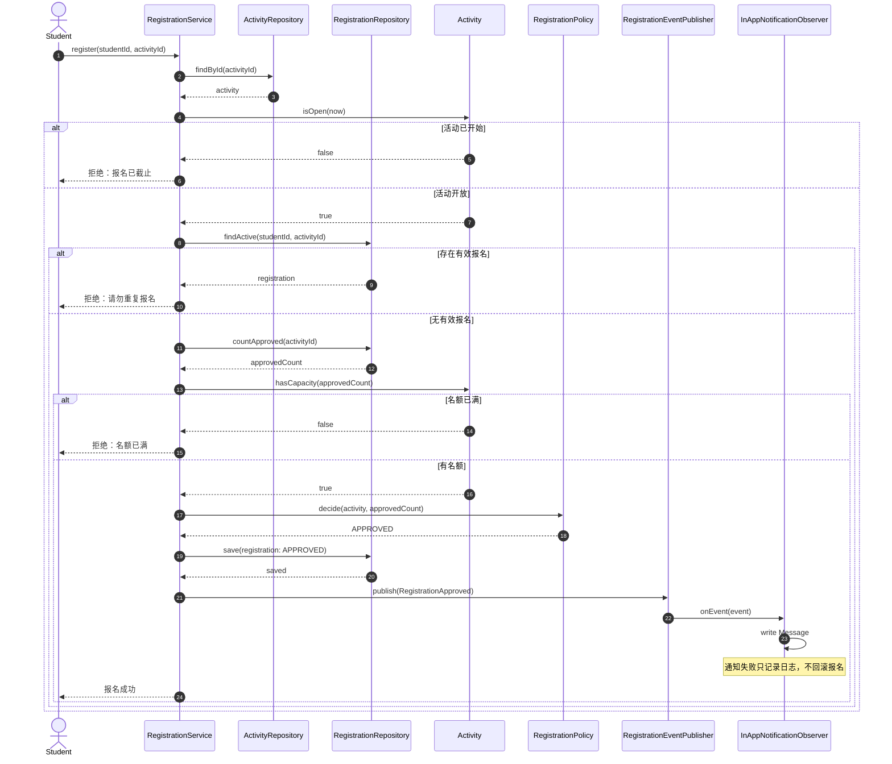

# 时序图：直接报名（UC-04）

**阶段**：初始版本设计，对应 `baseline-v1`  
**图形版本**：[直接报名时序图](diagrams/sequence-direct.drawio.svg)（draw.io 源文件见 `diagrams/CampusEvent-design.drawio`）

## 说明

- 容量检查、重复检查、活动开放检查是公共服务规则；`RegistrationPolicy` 只负责返回 `APPROVED`。
- 先保存并提交报名，再发布事件；通知属于提交后的副作用。
- 并发情况下事务开始对 Activity 行执行 SELECT ... FOR UPDATE，再重新计数，失败方按“名额已满”处理。
