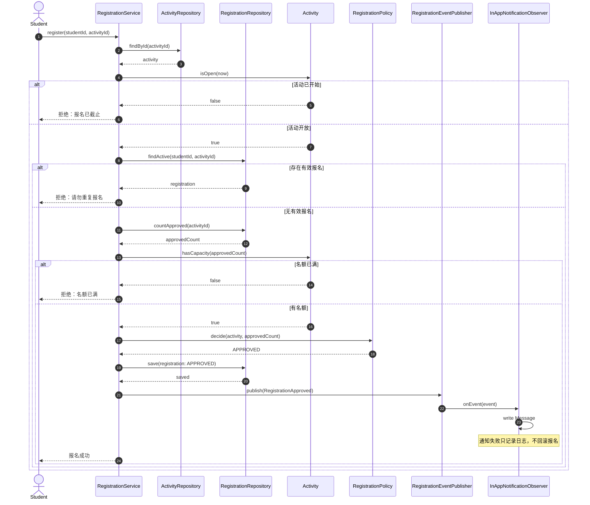

# 时序图：直接报名（UC-04）

**阶段**：设计 V1 基线 + change-v2 CR 标注（绿色=新增、黄色=修改；V1 快照见 `baseline-v1`）  
**图形版本**：[直接报名时序图](diagrams/sequence-direct.drawio.svg)（draw.io 源文件见 `diagrams/CampusEvent-design.drawio`）

## 说明

- 容量检查、重复检查、活动开放检查是公共服务规则；`RegistrationPolicy` 只负责返回 `APPROVED`。
- 先保存并提交报名，再发布事件；通知属于提交后的副作用。
- 并发情况下事务开始对 Activity 行执行 SELECT ... FOR UPDATE，再重新计数，失败方按“名额已满”处理。

## change-v2 图示变更点

- **CR-01**：`RegistrationPolicy.decide` 入参改为 `RegistrationContext`；直接报名新增 `GRADE_LIMITED_DIRECT` 分支，仅大二/大三通过。
- **CR-02**：新增 `EmailNotificationObserver`、`EmailSender`、`MockEmailSender`、`EmailLog`；直接报名事件为 `SUBMITTED` + 状态 `APPROVED`，在事务提交后发“报名成功”邮件。
- 邮件失败只记录 `EmailLog(FAILED)`，不回滚报名；同一有效报名不重复发。
- 本文件 Mermaid 仍为 V1 主流程；change-v2 以 SVG 底部“CR-01/CR-02 变更”说明为准。
