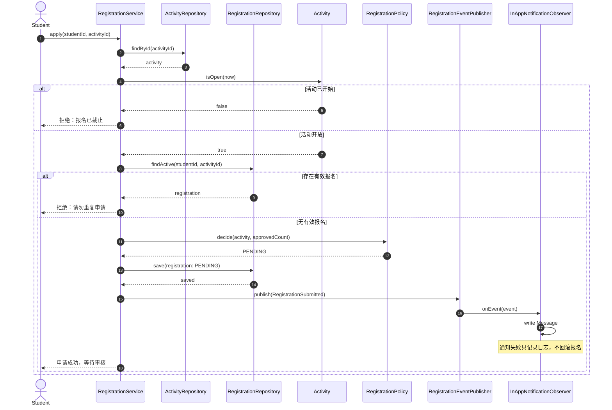

# 时序图：审核型报名（UC-05）

**阶段**：初始版本设计，对应 `baseline-v1`  
**图形版本**：[审核型报名时序图](diagrams/sequence-review.drawio.svg)（draw.io 源文件见 `diagrams/CampusEvent-design.drawio`）

## 说明

- 审核型报名提交时**不扣减名额**，待审核不占容量。
- 活动已满员时仍允许提交待审核申请；审批时再检查容量（UC-07）。
- 有效报名指状态为“待审核”或“已通过”；已取消/已拒绝允许再次申请。
