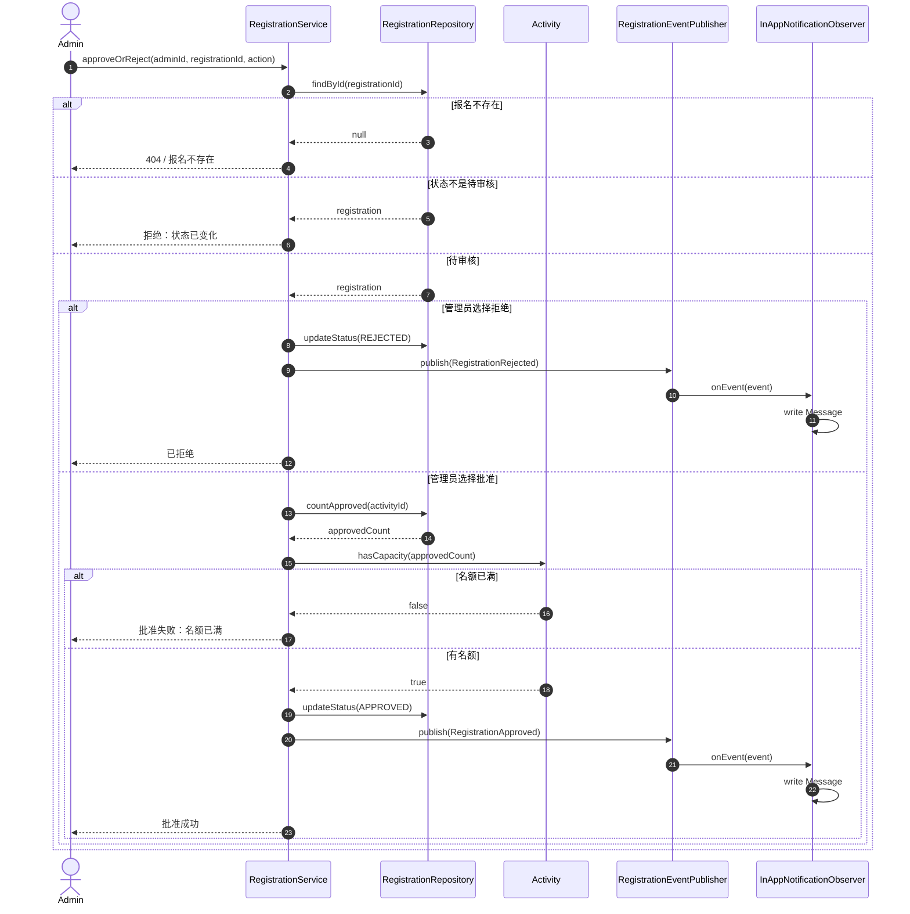

# 时序图：审批报名（UC-07）

**阶段**：设计 V1 基线 + change-v2 CR 标注（绿色=新增、黄色=修改；V1 快照见 `baseline-v1`）  
**图形版本**：[审批报名时序图](diagrams/sequence-approval.drawio.svg)（draw.io 源文件见 `diagrams/CampusEvent-design.drawio`）

## 说明

- 审批前必须重新检查“待审核”状态，避免重复审批。
- 批准时再次检查容量；名额已满时状态保持“待审核”，不超上限。
- 并发批准最后一个名额时，事务开始对 Activity 行执行 SELECT ... FOR UPDATE，再重新计数；只有一个成功。

## change-v2 图示变更点

- **CR-02**：批准/拒绝都会产生事件并发送邮件；邮件失败只记 `EmailLog`，不回滚审批。
- **CR-01**：审批主流程不增加年级判断；年级限制仅在直接报名策略。
- 重复审批由 `PENDING` 状态约束；图示不新增幂等键。
- 本文件 Mermaid 仍为 V1 主流程；change-v2 以 SVG 底部“CR-01/CR-02 变更”说明为准。
