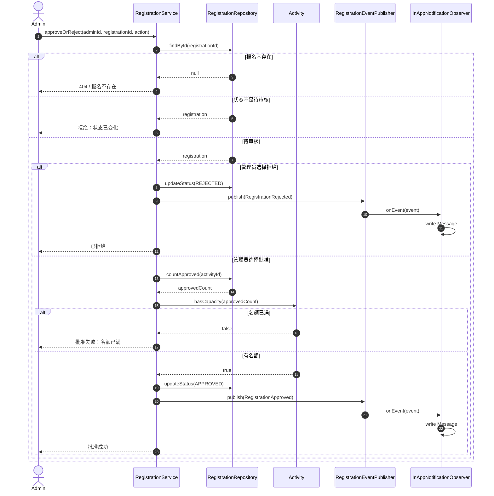

# 时序图：审批报名（UC-07）

**阶段**：初始版本设计，对应 `baseline-v1`  
**图形版本**：[审批报名时序图](diagrams/sequence-approval.drawio.svg)（draw.io 源文件见 `diagrams/CampusEvent-design.drawio`）

## 说明

- 审批前必须重新检查“待审核”状态，避免重复审批。
- 批准时再次检查容量；名额已满时状态保持“待审核”，不超上限。
- 并发批准最后一个名额时，事务内重新计数/乐观锁；只有一个成功。
